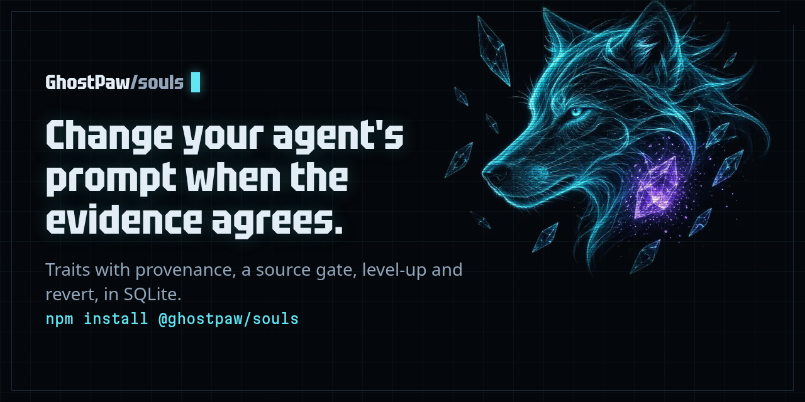
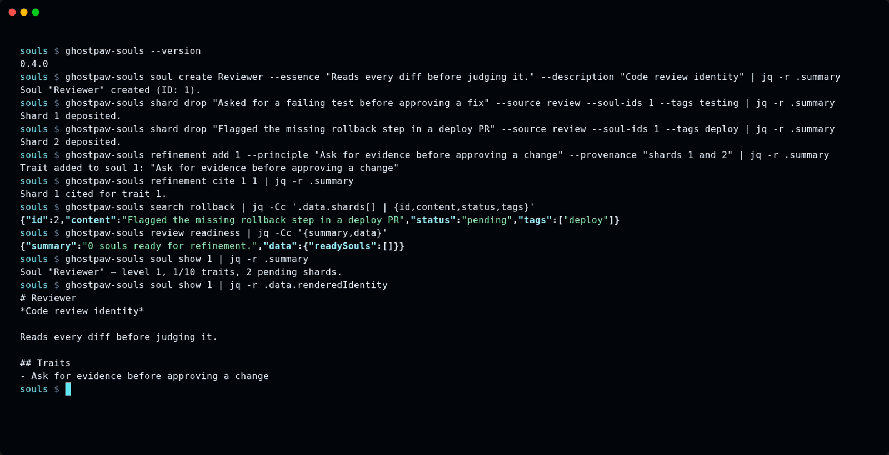

<a href="https://souls.ghostpaw.dev/"></a>

# @ghostpaw/souls

[](https://www.npmjs.com/package/@ghostpaw/souls) [](https://github.com/GhostPawJS/souls/actions/workflows/ci.yml) [](https://souls.ghostpaw.dev/) [](package.json) [](https://registry.modelcontextprotocol.io/v0.1/servers/io.github.GhostPawJS%2Fsouls/versions/latest) [](https://nodejs.org) [](LICENSE)

**Agent identity as an essence plus evidence-backed traits, refined only when the evidence agrees.**

```bash
npm install @ghostpaw/souls
```

Prompt evolution engine for cognitive identity. Stores identity as narrative
essence plus evidence-backed traits, with structured level-up,
crystallization-gated refinement, and full rollback. Not a prompt template
library. Not a configuration manager. An evolutionary algorithm for how agents
think.

Release binary with no runtime needed; library and npm usage require Node 24+. Zero runtime dependencies.

## MCP server

Every client below starts the same stdio server: `ghostpaw-souls mcp`.
For npm-based environments, use `npx -y @ghostpaw/souls mcp`.
Identity and evidence live in `~/.ghostpaw/souls.db` unless the `GHOSTPAW_SOULS_DB`
environment variable (absolute path) or `--db <path>` says otherwise.

**Claude Code**

```bash
claude mcp add ghostpaw-souls -- ghostpaw-souls mcp
```

or as a plugin, which also installs the skill:

```bash
/plugin marketplace add GhostPawJS/souls
/plugin install ghostpaw-souls@ghostpaw-souls
```

**Codex CLI** (`~/.souls/config.toml`)

```toml
[mcp_servers.ghostpaw-souls]
command = "ghostpaw-souls"
args = ["mcp"]
```

**Cursor** (`.cursor/mcp.json`), **Claude Desktop** (`claude_desktop_config.json`)
or a project `.mcp.json`:

```json
{
  "mcpServers": {
    "ghostpaw-souls": {
      "command": "ghostpaw-souls",
      "args": ["mcp"]
    }
  }
}
```

Claude Desktop users can also install `server.mcpb` from the
[latest GitHub release](https://github.com/GhostPawJS/souls/releases/latest).
A Dockerfile is included for container hosts:
`docker build -t ghostpaw-souls . && docker run -i --rm -v souls:/data ghostpaw-souls`.

The server speaks MCP 2026-07-28 (stateless, `server/discover`) and the
initialize-based revisions 2025-11-25, 2025-06-18, 2025-03-26 and 2024-11-05.

## CLI

```text
ghostpaw-souls search [query] [--soul-id N --tags TAG --limit N]
ghostpaw-souls review <list|maintenance|readiness>
ghostpaw-souls soul create <name> --essence TEXT --description TEXT
ghostpaw-souls soul show|update|retire|awaken <soulId> [flags]
ghostpaw-souls shard drop <content> --source LABEL --soul-ids N [flags]
ghostpaw-souls shard drop-batch --shards JSON
ghostpaw-souls shard reveal <shardIds...>
ghostpaw-souls refinement add|attune <soulId> [flags]
ghostpaw-souls refinement revise|revert|reactivate <traitId> [flags]
ghostpaw-souls refinement cite <traitId> <shardId>
ghostpaw-souls level validate|up|revert <soulId> [flags]
ghostpaw-souls mcp|skill|tools|describe|call|completions|version|help
```

Use `ghostpaw-souls skill --short` for a compact cheat sheet, `skill` for full
parameter tables, and `skill --list` to list runnable workflow guides.

Global flags can appear anywhere: `--db <path>`, `--json`, `--quiet`,
`--compact`, `--help`/`-h`, `--version`/`-V`/`-v`, `--no-color`.
`NO_COLOR` is accepted; output uses no terminal colors.
Noun-verb commands print the full tool result as JSON with `--json` or when
stdout is piped. Terminal output shows the summary and payload.
`--quiet` suppresses stdout. `--compact` removes JSON indentation.

Use `help soul`, `soul --help` or `soul create --help` for schema-derived help.
Array flags repeat and kebab-case flags map to schema properties. Values are
literal, including a leading `@`. Only `soul create|update --essence` reads a
file: `@path` (relative to the working directory), `@-` for stdin and `@@text`
for a literal `@text`. Help marks it `(@file, @- stdin, @@ literal @)`; an empty or unreadable path
exits 2. `--` ends flags. A positional `-`, or piped stdin
with no arguments, reads a JSON object; explicit flags override its fields.
Database selection uses `--db`, `GHOSTPAW_SOULS_DB`, then `~/.ghostpaw/souls.db`.

| Exit | Noun-verb result |
|---|---|
| 0 | Success, including no_op |
| 1 | Tool error |
| 2 | Usage or schema error |
| 3 | Clarification needed or not found |
| 4 | Conflict or version mismatch |
| 70 | Internal error |

Errors go to stderr. With `--json`, usage and internal errors also print
`{ok:false,error:{code,message}}` to stdout. Tool results retain their full
shape. Legacy `tools [--json]`, `describe <tool>`, `call <tool> [JSON|-]`
and `<tool_name> --parameter value` keep their existing exit codes.
`completions bash`, `completions zsh` and `completions fish` print shell scripts.

```sh
ghostpaw-souls soul create Reviewer --essence "Read carefully." --description "Review identity" --db /tmp/souls-example.db --json
ghostpaw-souls soul show 1 --db /tmp/souls-example.db --json
ghostpaw-souls review list --db /tmp/souls-example.db --json
```

Search reads behavioral shards. Creating a soul does not add searchable shards;
use `shard drop` to deposit observations. Core commands work offline.
## Agent Skill

`SKILL.md` (repo root) and `skills/souls/SKILL.md` follow the
[Agent Skills](https://agentskills.io) format and ship in the npm package.
Copy `skills/souls/` into your agent's skills folder, or print it:

```bash
ghostpaw-souls skill > SKILL.md
```

## Install

### Release binary (default)

Each line downloads the latest release asset, checks it against the release's SHA256SUMS and installs it on the PATH (~/.local/bin on Linux/macOS; the Windows script adds its folder to the user PATH).

These lines never edit ~/.profile or other shell startup files: `export PATH` applies to the current shell only. To keep it in new shells, use the `~/.profile` line below.

linux-x64:

```sh
curl -fsSL https://raw.githubusercontent.com/GhostPawJS/souls/main/install.sh | sh -s -- --target linux-x64 && export PATH="$HOME/.local/bin:$PATH"
```

linux-arm64:

```sh
curl -fsSL https://raw.githubusercontent.com/GhostPawJS/souls/main/install.sh | sh -s -- --target linux-arm64 && export PATH="$HOME/.local/bin:$PATH"
```

darwin-arm64:

```sh
curl -fsSL https://raw.githubusercontent.com/GhostPawJS/souls/main/install.sh | sh -s -- --target darwin-arm64 && export PATH="$HOME/.local/bin:$PATH"
```

darwin-x64:

```sh
curl -fsSL https://raw.githubusercontent.com/GhostPawJS/souls/main/install.sh | sh -s -- --target darwin-x64 && export PATH="$HOME/.local/bin:$PATH"
```

windows-x64 (PowerShell; persistently adds the install folder to the user PATH):

```powershell
irm https://raw.githubusercontent.com/GhostPawJS/souls/main/install.ps1 | iex
```

Pinned to a release:

```sh
curl -fsSL https://raw.githubusercontent.com/GhostPawJS/souls/main/install.sh | sh -s -- --target linux-x64 --version 0.4.5 && export PATH="$HOME/.local/bin:$PATH"
```

Also adding ~/.local/bin to ~/.profile (edits ~/.profile once; skipped if it already mentions ~/.local/bin; zsh login shells read ~/.zprofile instead, so use that file name there):

```sh
curl -fsSL https://raw.githubusercontent.com/GhostPawJS/souls/main/install.sh | sh -s -- --target linux-x64 && { grep -qs '.local/bin' ~/.profile || echo 'export PATH="$HOME/.local/bin:$PATH"' >> ~/.profile; } && export PATH="$HOME/.local/bin:$PATH"
```

To skip the persistent user PATH edit (the installer prints the folder to add):

```powershell
$env:GHOSTPAW_NO_MODIFY_PATH=1; irm https://raw.githubusercontent.com/GhostPawJS/souls/main/install.ps1 | iex
```

```text
$ ghostpaw-souls --version
souls 0.4.5 (binary, linux-x64)
```

Scripts that compare versions should use `--version --short` or `--version --json`.

A session with the 0.4.0 linux-x64 binary against a fresh database (output piped through `jq` to keep it short):



The same session as an [animated GIF](https://raw.githubusercontent.com/GhostPawJS/souls/main/docs/assets/cli.gif).

Other release installers:

```sh
mise use -g github:GhostPawJS/souls
ubi --project GhostPawJS/souls --exe ghostpaw-souls --in ~/.local/bin
eget GhostPawJS/souls
```

For [aqua](https://aquaproj.github.io/docs/reference/registry-config/), define a
`github_release` package in `aqua.yaml`:

```yaml
registries:
  - name: souls
    type: local
    path: souls-registry.yaml
packages:
  - name: GhostPawJS/souls@v<VERSION>
    registry: souls
```

`souls-registry.yaml`:

```yaml
packages:
  - type: github_release
    repo_owner: GhostPawJS
    repo_name: souls
    asset: ghostpaw-souls-{{trimV .Version}}-{{.OS}}-{{.Arch}}.tar.gz
    format: tar.gz
    replacements: { amd64: x64 }
    overrides:
      - goos: windows
        asset: ghostpaw-souls-{{trimV .Version}}-windows-{{.Arch}}.zip
        format: zip
    files:
      - name: ghostpaw-souls
```

Install scripts verify SHA256SUMS. To verify a downloaded archive's
[build attestation](https://cli.github.com/manual/gh_attestation_verify):

```sh
gh attestation verify <archive> -R GhostPawJS/souls
```

Set `GHOSTPAW_VERIFY=attestation` for attestation verification in `install.sh`.
Binaries are unsigned; macOS binaries carry an ad-hoc signature. For a browser
download on macOS, remove quarantine with
`xattr -d com.apple.quarantine /path/to/ghostpaw-souls`.
Linux binaries require glibc 2.28+; use npx on Alpine.
See the [binary build workflow](.github/workflows/release-binaries.yml).

Sizes for 0.4.0 (Node 26.12.1 inside each binary):

| Target | Archive | Binary |
|---|---|---|
| linux-x64 | 41.7 MB tar.gz | 117.4 MB |
| linux-arm64 | 41.1 MB tar.gz | 115.1 MB |
| darwin-arm64 | 44.8 MB tar.gz | 146.7 MB |
| darwin-x64 | 46.4 MB tar.gz | 149.5 MB |
| windows-x64 | 38.4 MB zip | 105.6 MB |

The npm package is 930 KB unpacked and needs Node 24+. Every release is
installed and run on ubuntu-24.04, macos-15 and windows-2025 by the
[install check](.github/workflows/install-check.yml).

Release install checks run on ubuntu-24.04, macos-15 and windows-2025.
### npx / npm (for npm-based environments)

The [npm package](https://www.npmjs.com/package/@ghostpaw/souls) requires Node 24+:

```sh
npm install -g @ghostpaw/souls
npx -y @ghostpaw/souls --help
```

### Library (for harnesses embedding it in code)

```sh
npm install @ghostpaw/souls
```

```ts
import { initSoulsTables, read, write } from '@ghostpaw/souls';
```

See [Quick Start](#quick-start) for library usage.

## Quick Start

```ts
import { DatabaseSync } from 'node:sqlite';
import { initSoulsTables, read, write } from '@ghostpaw/souls';

const db = new DatabaseSync(':memory:');
initSoulsTables(db);

const soul = write.createSoul(db, {
  name: 'Reviewer',
  essence: 'I review code by reading for intent before scanning for bugs.',
  description: 'Code review specialist',
});

write.addTrait(db, soul.id, {
  principle: 'Read the PR description before the diff.',
  provenance: 'Reviews that started with code missed architectural intent 3 of 4 times.',
});

write.dropShard(db, {
  content: 'Reviewer caught a naming inconsistency by reading the RFC first.',
  source: 'session',
  soulIds: [soul.id],
});

const rendered = read.renderSoul(db, soul.id);
```

## Docs

The live demo runs the library in your browser against an in-memory SQLite database. Each view below opens a different part of it:

- [Roster](https://souls.ghostpaw.dev/docs/): every soul and its current traits
- [Create Soul](https://souls.ghostpaw.dev/docs/#/create): start a new identity
- [Observe](https://souls.ghostpaw.dev/docs/#/observe): log evidence about a soul's behaviour
- [Maintenance](https://souls.ghostpaw.dev/docs/#/maintenance): consolidate and refine traits
- [Search](https://souls.ghostpaw.dev/docs/#/search): full-text search across souls
- [The Ether](https://souls.ghostpaw.dev/docs/#/ether): the prompt catalog

| Document | Audience |
|----------|----------|
| [CONCEPT.md](CONCEPT.md) | Full design rationale, research citations, invariants |
| [docs/LLM.md](docs/LLM.md) | LLM harness builders — tool surface, rendering, soul layer |
| [docs/HUMAN.md](docs/HUMAN.md) | Human developers — direct read/write/ether API |
| [docs/PAGES.md](docs/PAGES.md) | Demo app pages, architecture, development |
| [docs/entities/](docs/entities/) | Entity deep-dives: souls, traits, shards, levels, ether |

## What It Does

A **soul** is one cognitive identity — not a prompt template, not a config
object. How an agent thinks, judges, and approaches problems.

A **trait** is a cognitive principle with provenance — evidence proving it was
earned, not invented.

A **shard** is a behavioral observation from any source, attributed to souls.
Shards accumulate silently. When enough evidence converges across independent
channels over time, the soul becomes eligible for refinement.

**Level-up** consolidates: merge overlapping traits, promote absorbed ones into
the essence, carry forward those still teaching. The identity restructures and
the generation counter increments.

The rendered identity block (essence + active traits) is static between
mutations — no drift, no context accumulation, no re-rendering overhead. It
does not drift because there is nothing to drift.

## API Surface

```ts
import { read, write, ether, soul, tools, skills } from '@ghostpaw/souls';
```

| Namespace | Purpose |
|-----------|---------|
| `read` | Queries — get souls, traits, shards, evidence reports, render identity blocks |
| `write` | Mutations — create souls, add/revise/revert traits, drop shards, level up |
| `ether` | Soul template discovery — search ~2,800 open-source prompts, manifest as souls |
| `soul` | The built-in Mentor soul — gardener identity for guiding refinement |
| `tools` | LLM tool facade — JSON Schema definitions for agent framework integration |
| `skills` | Markdown procedures — crystallization, refinement, level-up, maintenance workflows |

### Core Lifecycle

```
observe → crystallize → refine → level up → repeat
```

Shards accumulate from any source. Crystallization gates refinement until
evidence converges across 2+ independent channels over 1+ days. Traits mutate
with provenance. Level-up restructures when the identity outgrows its current
form.

### The Mentor

The package ships one built-in soul — the Mentor — tuned for guiding the
entire refinement lifecycle:

```ts
import { soul } from '@ghostpaw/souls';

const systemPrompt = soul.renderSoulsSoulPromptFoundation();
```

### Ether — Template Discovery

Browse and search a catalog of open-source system prompts, then manifest them
as fully-formed souls:

```ts
import { DatabaseSync } from 'node:sqlite';
import { ether } from '@ghostpaw/souls';

const etherDb = new DatabaseSync('ether.db');
ether.initEtherTables(etherDb);
ether.registerDefaults(etherDb);
await ether.refreshAll(etherDb);

const [hit] = ether.search(etherDb, 'security architect');
const entry = hit ? ether.getEntry(etherDb, hit.id) : undefined;
const newSoul = entry ? ether.manifest(soulsDb, entry) : undefined;
```

Sources are fetched lazily with ETag caching. Refresh is atomic — failed
fetches never erase existing data.

### LLM Tools

Wire into any agent framework via JSON Schema tool definitions:

```ts
import { tools } from '@ghostpaw/souls';

const allTools = tools.listSoulsToolDefinitions();
const tool = tools.getSoulsToolByName('search_souls');
const result = tool?.handler(db, { query: 'architect' });
```

## Ecosystem

Souls is one of four faculties in the GhostPaw cognitive substrate:

| Faculty | Domain | Core Loop |
|---------|--------|-----------|
| **questlog** | tasks and commitments | plan, track, complete, reward |
| **affinity** | people and relationships | meet, bond, interact, maintain |
| **codex** | beliefs and knowledge | remember, recall, revise, flag |
| **souls** | cognitive identity | observe, crystallize, refine, level up |

Each faculty owns one slice of state. Each stays lean at the storage layer
with the same architecture: Node 24+, built-in `node:sqlite`, zero runtime
dependencies.

Souls is unique in the quartet: it is the only faculty whose output becomes
the system prompt. Questlog produces task state. Affinity produces relationship
state. Codex produces belief state. Souls produces the identity block that
shapes how all other state is interpreted.

Together they form a complete cognitive substrate for agents that grow.

## Domain Mapping

The engine provides a single abstraction — identity that evolves from
evidence — that maps to any domain where behavior should improve from
observation:

| Domain | Soul is | Traits are |
|--------|---------|------------|
| LLM agents | agent identity | behavioral principles |
| Game NPCs | NPC personality | character qualities |
| AI companions | companion identity | personality facets |
| Creative writing | fictional character | character traits |
| Brand voice | brand identity | voice guidelines |
| Educational tutor | teaching style | pedagogical principles |
| Code review | reviewer style | team preferences |

## Demo

An interactive local-first demo app with RPG character sheet aesthetics:

```bash
npm run demo:ether   # fetch template catalog
npm run demo:serve   # build and serve at localhost:7777
```

## License

MIT

### Evidence-backed refinement

Shard lists and searches return arrays with a default limit of 100 (maximum
1000). `read.listShardsPage` and `read.searchShardsPage` return
`{ items, total, hasMore }`; use `offset` to continue. Both accept `status`:
`pending`, `sealed`, `faded`, or `all`. Lists default to pending unsealed shards;
searches retain their all-status default. Query and tags combine with AND.

Trait additions and essence edits warn when crystallization is not ready or no
`shardIds` are supplied. Pass `strict: true` to require both. A named `operator`
bypasses this gate and records an operator correction. Existing trait-addition
capacity enforcement is unchanged; reactivation and new level-up checks warn
unless strict is enabled. `addTrait`, `updateSoul`, and `refineWithEvidence` expose optional
`warnings: string[]` as a non-enumerable property,
so serialization and object spreads keep the record clean. Facade
data also includes these strings while retaining existing warning objects.
The CLI prints each warning as `warning: ...` on stderr.

`write.refineWithEvidence(db, { soulId, action: 'add' | 'revise', traitId?,
principle, provenance, shardIds, reason?, strict?, operator?, expectedRevision? })`
updates wording, cites evidence, and stamps attunement atomically. Set
`expectedRevision` to the latest revision ID for the soul (or 0) to detect
conflicts. Read wording history with `read.getRevisionHistory(db, { soulId,
traitId?, limit? })`, or inspect with `history: true`.

The facade action is `refine_with_evidence`; CLI usage:

```sh
ghostpaw-souls refinement apply 1 --principle "Check assumptions" --provenance "Review evidence" --shard-ids 2,3 --strict
ghostpaw-souls refinement revise 4 --principle "Check assumptions first" --reason "Clarify order"
ghostpaw-souls soul update 1 --essence "Corrected identity" --strict --operator maintainer --reason "Correction"
```

`refinement apply` infers revise when `--trait-id` is supplied; otherwise it adds.
Evidence reports render at most five members per cluster and show `+N more`.
Set `maxMembersPerCluster` to change the cap, or `full: true` to retain every
selected member in the structured payload. Alignment uses the maximum
similarity across all cluster members. Staleness uses the latest citation time,
falling back to trait creation. Tension detection has English-only negation
cues; `detectTraitTensions(..., { negationWords })` extends them.

`read.formatEvidence(db, soulId, { negationWords: ["nicht"] })` extends the
English-only tension cues through the public library facade.

### Publishing identities into host prompts

```sh
ghostpaw-souls soul create Reviewer --essence 'Read intent first.' --description 'Code review' --external-id reviewer
ghostpaw-souls render ext:reviewer --provenance
ghostpaw-souls render ext:reviewer --into ./AGENTS.md --marker souls --budget 8000 --expect-hash none
ghostpaw-souls diff ext:reviewer --against ./AGENTS.md
ghostpaw-souls review ext:reviewer --no-change --reason 'Identity still fits'
ghostpaw-souls config set strict true
ghostpaw-souls config get strict
ghostpaw-souls report --expect-ids @expected-ids.txt
```

`render` prints only the identity, or atomically creates/replaces the content between
`<!-- souls:begin -->` and `<!-- souls:end -->` with `--into`. It appends a block when
markers are absent. `--marker` selects a different marker name. Successful writes
print `wrote <file> sha256:<hash>` and record file/block hashes in `soul_publications`.
`--expect-hash` requires the current full-file SHA-256 (`none` for a missing file);
a mismatch exits 4 without writing. Omit it for an unconditional replacement.

`--budget` counts characters across the entire composed output, including surrounding
file text and markers. It removes lowest-ranked traits first, then shortens essence;
very small budgets can empty the identity block. Text outside the markers stays
intact. An impossible budget exits nonzero without writing. Cuts appear as one
`trimmed:` line on stderr and as `{traitIds, essenceChars}` in `--json` output.
`diff` prints changed lines, exits 0 when identical and 1 when different; `--json`
returns `{same, added, removed, markerFound}`. When no block exists for the requested
marker, `diff <soul> --against <file|->` compares the whole input, removing one
trailing newline, with the rendered block and reports `markerFound: false`.
Diff compares the current full identity, so a
budget-trimmed publication can differ.

Soul create/update accept `--external-id`; bindings are unique when set and appear
in show/list JSON. CLI soul arguments accept numeric IDs, names, or `ext:<id>`.
`report --expect-ids @file` reads one external ID per line (`@-` reads stdin), compares
active bindings, and prints `missing:` and `extra:` lines. It exits 0 for a match,
1 otherwise; JSON returns `{missing, extra}`.

Shard drop accepts `--occurred-at <iso>`, `--idempotency-key <key>`, and `--ref <text>`.
Repeated ingestion keys return the original shard with `duplicate: true`. Library
and batch inputs accept `occurredAt` (ISO or epoch milliseconds), `idempotencyKey`,
and `ref`. Occurrence time controls crystallization age/spread, falling back to
creation time. The age spread uses `occurredAt` (falling back to `createdAt`): two pending
shards from different sources must be at least one day apart, or live shards
(occurrence time not earlier than insertion time) must span a day on their own.
Otherwise readiness reports `Age spread must span at least two sources by occurrence time.` Legacy numeric CLI and facade occurrence timestamps retain their creation-time
behavior; `insertedAt` records insertion time separately for backfill checks.

Strict checks default off. Resolve strict in this order: explicit library `strict`
or CLI `--strict`/`--no-strict`, `GHOSTPAW_SOULS_STRICT` (`1/true/yes` or
`0/false/no`), then the database setting. Use `config set strict true|false`,
`config get [key]`, and `config list`. Both read commands report effective boolean values and a `source` of `default`, `db`, or `env`; text output uses `strict: false (default)`. `read.getSoulsConfig(db)` reads persisted
values; `write.setSoulsConfig(db, 'strict', 'true')` writes them. The manage tool
provides `config_set`, `config_get`, and `config_list` actions.

Refinement add/revise and soul update accept `--operator <name>` for a logged
operator correction; strict evidence readiness can be bypassed with a named
operator. Review output includes corrections. `review --no-change` records a review
and stamps attuned without editing identity; the facade provides
`write.reviewNoChange(db, soulId, {reason})` and the review tool accepts `noChange`.
Show with `--history` includes revision and review records. Refinement
add/reactivate/apply and level validate/up accept `--trait-limit <n>`.

CLI batch ingestion accepts `shard drop-batch --shards @file` and
`shard add --batch @file` with a JSON array or JSON Lines. `@-` reads stdin;
`@@` escapes a literal leading at-sign. `shard add` also aliases `shard drop`.
Set `GHOSTPAW_OUTPUT=json` for JSON output. Default database opens print
`using default db <path>` on stderr; suppress with `--quiet` or
`GHOSTPAW_QUIET=1`, or select `--db` / `GHOSTPAW_SOULS_DB`.

### Reference, render, and readiness options

Soul references resolve in this order: numeric ID, `ext:<externalId>`, slug,
then name. For example, after `soul create Reviewer --slug mentor --essence E
--description D`, use `render mentor` or `soul show mentor`. Tool `soulId` and
`soulIds` inputs also accept these references, including shard batch entries.
Unresolved or ambiguous references report what was tried.

`-q, --quiet` suppresses stdout wherever quiet output is supported. Array flags
can be repeated or receive a JSON array, for example `--tags one --tags two` or
`--tags '["one","two"]'`. Commas stay literal. Batch shard import uses
`shard add --batch @file` or `shard drop-batch --shards @file` (JSON array or
JSON Lines; `@-` reads stdin).

Rendering defaults to citation count descending, then creation time ascending.
Use `render <soul> --order density` for citations per day of trait age (minimum
one day). `--provenance` includes trait provenance; `--no-provenance` omits it
(the stored-soul default). Library options are `order: 'citations' | 'density'`
and `includeProvenance`. The built-in foundation keeps provenance by default;
pass `{ includeProvenance: false }` as its second argument to omit it.

Readiness and maintenance options accept `minSourceDiversity` (positive integer,
default 2) and `minSpreadDays` (non-negative number, default 1). These propagate
through profile, shard-drop, and evidence-gated mutation options. Tools expose
the same optional fields; corresponding CLI flags are `--min-source-diversity`
and `--min-spread-days` on review, inspection, observation, and refinement
commands, plus `level validate` without a plan. Occurrence-time spread, recency, pending count, and cluster diversity
still apply; backfilled observations must span sources when native spread is
insufficient.

`soul update <soul> --essence E --shard-ids 1 --shard-ids 2 --reason text` cites
shards for an essence change. A named `--operator` with a `--reason` suppresses
evidence warnings when strict mode is off; strict behavior stays unchanged.
`level validate <soul>` reports readiness and blockers with exit 0 when the
check runs. Supply a plan as inline JSON, for example `--plan '{"newEssence":"E","consolidations":[],"promotedTraitIds":[],"carriedTraitIds":[]}'`.
With a plan, validation behavior is unchanged.

Profiles include `freshness`, `headroom`, and `evidenceRatio`; `health` is their
product, clamped to 0–1. See [soul rendering and health](docs/entities/SOULS.md)
for the component formulas. Evidence suggestions count uncited clusters
separately from semantically novel ones. Citations onto active traits count as
alignment; singleton and single-source clusters do not prompt a new trait.
